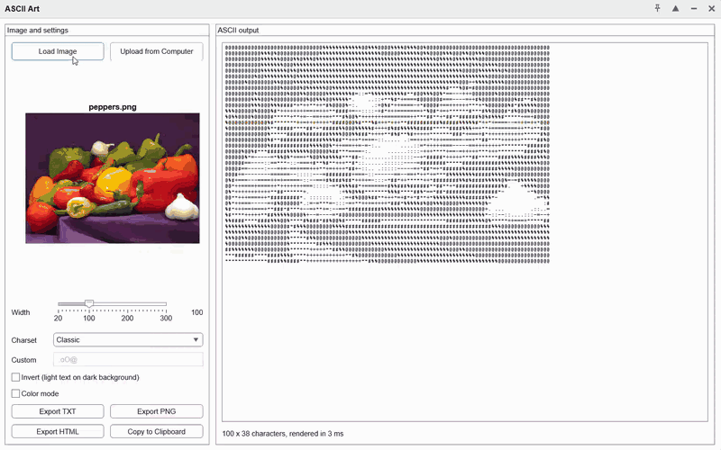
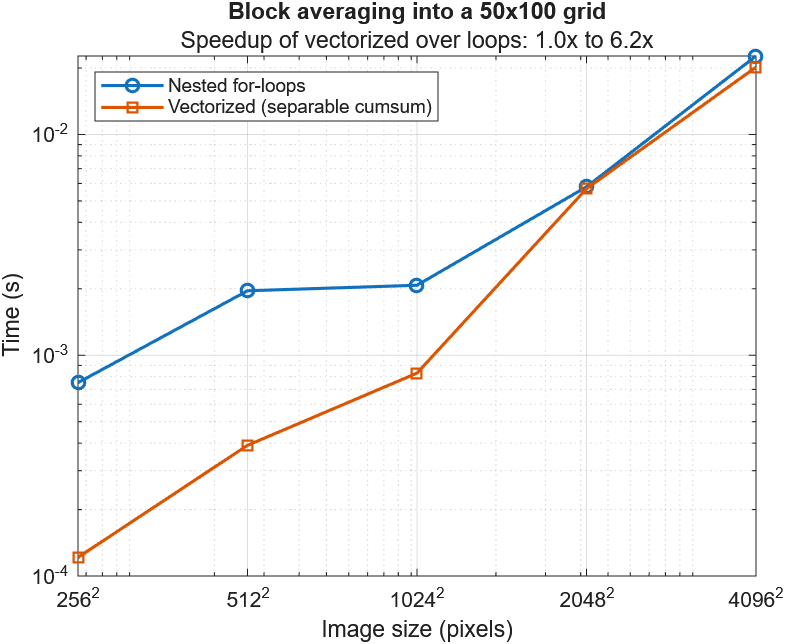

# asciiart

Convert images to ASCII art in MATLAB, with color output, export to text/PNG/HTML, and an interactive app, using base MATLAB only.



## Features

- **Image to ASCII** with `img2ascii`: grayscale or RGB input as a file name or array (`uint8`, `uint16`, `single`, `double`, `logical`)
- **Configurable output**: width, character set (including Unicode such as `░▒▓█`), invert for dark backgrounds, aspect ratio correction
- **Tone controls**: contrast stretch or histogram equalization, gamma, and edge sharpening
- **Color mode** with `img2asciiColor`: the average RGB color behind every character
- **Export** to UTF-8 text (`ascii2txt`), PNG (`ascii2png`), and standalone colored HTML (`ascii2html`)
- **Interactive app** (`AsciiArtApp`) with live preview, debounced updates, and image upload from your own computer, even in MATLAB Online
- **Vectorized core**: block averaging with cumulative sums, benchmarked against a loop implementation
- **No toolboxes**: no Image Processing Toolbox or any other add-on
- **Tested**: `matlab.unittest` suites with parameterized tests and a code coverage report

## Quick Start

```matlab
addpath("src")

% Grayscale ASCII art in the Command Window
txt = img2ascii("peppers.png", Width=80);
disp(txt)

% Light text for a dark-themed Command Window, with block characters
disp(img2ascii("peppers.png", Width=80, Invert=true, Charset=" ░▒▓█"))

% Color HTML
[txt, colors] = img2asciiColor("peppers.png", Width=120, Invert=true);
ascii2html(txt, colors, "peppers.html");
web("peppers.html")

% Interactive app
addpath("app")
AsciiArtApp
```

For a guided tour, open [examples/GettingStarted.m](examples/GettingStarted.m) as a Live Script: right-click the file and select **Open as Live Script**.

**Requirements:** MATLAB R2023a or newer (developed in MATLAB Online). No toolboxes.

## Folder Structure

```
asciiart/
├── src/                         Core functions (public API)
│   ├── img2ascii.m              Image → char matrix
│   ├── img2asciiColor.m         Image → char matrix + per-character RGB
│   ├── adjustTone.m             Contrast, gamma, and sharpening
│   ├── ascii2txt.m              Save as UTF-8 text
│   ├── ascii2png.m              Render to an image file
│   ├── ascii2html.m             Save as colored HTML
│   └── private/                 Internal helpers, not part of the API
│       ├── blockMeanVectorized.m   Block averaging with cumsum (used)
│       ├── blockMeanLoop.m         Reference loop implementation
│       ├── blockEdges.m            Block boundaries shared by both
│       ├── loadImage.m             Read and normalize images
│       └── mustBeImageSource.m     Argument validator
├── app/
│   ├── AsciiArtApp.m            Programmatic uifigure app (plain text, no .mlapp)
│   └── uploadButton.html        Browser file picker used by the app
├── tests/
│   ├── Img2AsciiTest.m          Core conversion tests
│   ├── ExportTest.m             TXT and PNG export tests
│   ├── ColorTest.m              Color mode and HTML tests
│   └── runAllTests.m            Runs everything, prints a table, writes coverage
├── docs/
│   ├── benchmark.png            Benchmark plot used in this README
│   └── demo.gif                 App screen capture used in this README
├── examples/
│   ├── GettingStarted.m         Guided tour (open as Live Script)
│   ├── demo_basic.m             Convert and display an image
│   ├── demo_export.m            Save as TXT, PNG, and HTML
│   └── benchmark_blockmean.m    Loop vs. vectorized timing plot
└── README.md
```

## Running the Tests

```matlab
run("tests/runAllTests.m")
```

This runs every `*Test.m` class in `tests/`, prints a results table, and writes an HTML coverage report for `src/` (including `src/private`) to `coverage/index.html`. The script ends with `assertSuccess`, so it errors if any test fails and can be used in CI.

To run a single class:

```matlab
results = runtests("tests/Img2AsciiTest.m");
```

The tests cover output size, brightness mapping in both directions, monotonicity on gradients, identical results across input types (including a PNG file), edge cases (1×1, very wide and very tall images, upsampling), invalid inputs, tone options, Unicode charsets, export round trips, color output, and loop/vectorized equivalence on random inputs.

## Design Decisions

### Vectorized block averaging

Downsampling an H×W image to the character grid means averaging the pixels in each block. A direct approach loops over every pixel of every block. The vectorized version uses cumulative sums instead: with `C = cumsum(A, 1)`, the sum of rows `r0+1` through `r1` is `C(r1,:) - C(r0,:)`, so indexing `C` with vectors of block edges reduces the image to one row per block in a single pass. The same step along the columns then runs on that much smaller matrix.

Why this approach:

- **Uneven sizes:** a `reshape`/`sum` approach only works when the image size is an exact multiple of the grid. Cumulative sums work for blocks of any size, so nothing is cropped or padded.
- **One pass over the image:** a full 2-D summed-area table would also work, but it makes several passes over the full-size image plus a padded copy. The separable version touches every pixel only once.
- **Verified:** the loop version is kept as a reference. Both are checked against each other and against `reshape` + `mean` in the tests.

[examples/benchmark_blockmean.m](examples/benchmark_blockmean.m) times both with `timeit` from 256² to 4096² pixels (MATLAB Online, 50×100 output grid):



| Image size | Loop | Vectorized | Speedup |
|---|---|---|---|
| 256×256 | 0.75 ms | 0.12 ms | 6.2× |
| 512×512 | 1.96 ms | 0.39 ms | 5.0× |
| 1024×1024 | 2.08 ms | 0.83 ms | 2.5× |
| 2048×2048 | 5.79 ms | 5.68 ms | 1.0× |
| 4096×4096 | 22.7 ms | 20.2 ms | 1.1× |

**What the results show:**

- **Up to 1024², vectorized is 2.5–6× faster.** The loop pays interpreter overhead for each of the 5,000 blocks; `cumsum` and indexing run as a few optimized built-in calls.
- **From 2048², the two tie.** A 2048² double image is 32 MB, too large for the CPU cache, so both versions become *memory-bound*: their speed is set by how fast the image can be read from RAM, not by computation. The vectorized curve jumps sharply at exactly this size. `cumsum` also writes a full-size temporary matrix, which adds memory traffic. The loop, compiled by MATLAB's JIT, already runs at about 1.4 ns per pixel, close to the memory limit.

So vectorization helps most when the data fits in cache, and above that both versions are limited by memory bandwidth. The vectorized version is kept because it is never slower, it is shorter, and it handles uneven block sizes in a few lines.

### No toolbox dependencies

Everything uses base MATLAB, so the project runs on any MATLAB installation, including MATLAB Online without add-ons. It also meant implementing the image-processing steps directly rather than calling `imresize`, `blockproc`, `rgb2gray`, or `histeq`:

| Toolbox function | Replaced by |
|---|---|
| `imresize` / `blockproc` | Block averaging with cumulative sums |
| `rgb2gray` | Rec. 601 luminance weights (0.299, 0.587, 0.114), which sum to exactly 1 |
| `histeq` | 256-bin histogram equalization with `accumarray` and `cumsum` |
| `imsharpen` | Unsharp mask with `conv2` |

### Aspect ratio correction

Text characters are about twice as tall as they are wide. If each character covered a square block of pixels, the output would look stretched vertically. The number of rows is therefore scaled by `AspectCorrection` (default 0.5):

```
rows = round(Width * H/W * AspectCorrection)
```

It is an option rather than a constant because the right value depends on the font and line spacing. The HTML export uses a line height of 1.2, which matches 0.5 for typical monospace fonts.

### Other choices

- **`arguments` blocks** validate every public function's inputs, with errors that name the bad argument.
- **Private folder** for internals (`src/private`), so the public API is just the six functions in `src/`.
- **Error identifiers** follow `asciiart:category:specificError`:

  | Identifier | When |
  |---|---|
  | `asciiart:input:invalidImage` | Not an image, or not 1 or 3 channels |
  | `asciiart:input:fileNotFound` | Image file does not exist |
  | `asciiart:input:sizeMismatch` | Colors do not match the text size |
  | `asciiart:io:cannotOpenFile` | Output file cannot be written |
  | `asciiart:app:emptyCharset` | Custom charset is empty in the app |
  | `asciiart:app:uploadFailed` | Browser could not read an uploaded file |
  | `asciiart:app:unreadableUpload` | Uploaded file is not a supported image |

- **Programmatic app** instead of App Designer: plain-text `.m` code that is easy to diff, review, and keep in version control.

## Troubleshooting

| Symptom | Cause and fix |
|---|---|
| `Function 'X' has already been declared within this scope` | The file's contents were pasted twice, or pasted below the template that **New → Function** creates. Clear the file and paste the code once. `type <file>` shows the contents quickly. |
| `Undefined function 'img2ascii'` | `src/` is not on the path. Run `addpath("src")` from the project root, or run any example script, which adds it. |
| Busy photos look muddy | Each character averages a large patch of pixels. Increase `Width` (120–150), then try `Sharpen=1` and `Contrast="equalize"`. |
| ASCII art looks scrambled in the Command Window | Long lines are wrapping. Widen the window or use a smaller `Width`. |
| **Load Image** in the app cannot find a photo on your PC | In MATLAB Online, file dialogs only browse MATLAB Drive. Use **Upload from Computer**, or upload the file to MATLAB Drive first. |
| `░▒▓█` show as boxes | The font has no glyphs for these characters. Only the display is affected; the text is correct. |

## Lessons Learned

Problems hit during development and how the code handles them. Each one is also explained in a comment where the fix lives.

- **Private functions are only visible from the parent folder.** Tests and the benchmark live outside `src/`, so they temporarily make `src/private` the current folder (`CurrentFolderFixture` in tests, `cd` with a `try`/`catch` restore in the benchmark).
- **`TestSuite.fromFolder` treats every script as a test**, including `runAllTests.m` itself, which would run recursively. The runner collects only `*Test.m` files.
- **`rgb2gray`'s weights (0.2989, 0.5870, 0.1140) sum to 0.9999**, so a gray RGB image did not exactly match its grayscale version and pure white was not quite white. The exact Rec. 601 weights sum to 1.
- **Vectorized is not automatically faster.** MATLAB's JIT compiler runs simple scalar loops quickly. A full 2-D summed-area table makes several passes over the full image, so the separable version (one full-size pass) was used instead. Even then, on images too large for the CPU cache, both versions are limited by memory bandwidth and run at the same speed (see the benchmark above).
- **Docked figures ignore `Position` changes.** MATLAB Online may dock figures by default, so `ascii2png` creates its hidden figure with `WindowStyle="normal"` before sizing it to the text.
- **`uigridlayout` places each new component in the next free cell.** Setting `Layout.Column` afterwards can leave two components in the same cell, so the app sets every row and column explicitly.
- **The `uihtml` sandbox can block `blob:` URLs**, so `URL.createObjectURL` failed for every uploaded image. The upload button reads files with `FileReader` instead, and if the browser cannot decode an image, it sends the original bytes for `imread` to decode.

## Future Work

- **Edge-aware characters:** detect edge direction with gradients and draw outlines with `/ \ | _ -` for crisper shapes
- **Dithering** (Floyd–Steinberg) to show smoother gradients with few characters
- **Font-aware charsets:** render each glyph, measure its ink coverage, and sort characters automatically for any font
- **ANSI color output** for terminals, in addition to HTML
- **Video and webcam** input, converting frame by frame
- **Packaging** as a toolbox (`.mltbx`), with CI using MATLAB's GitHub Actions
